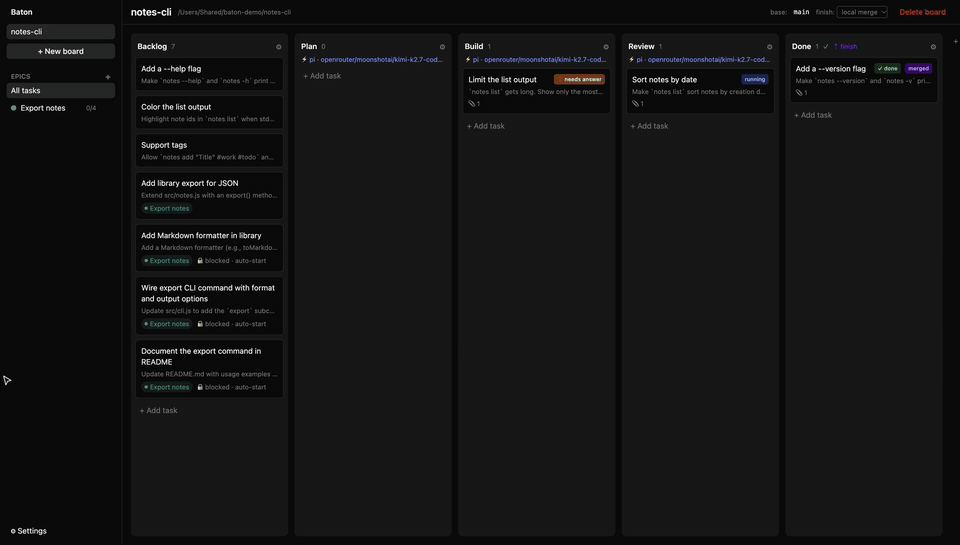
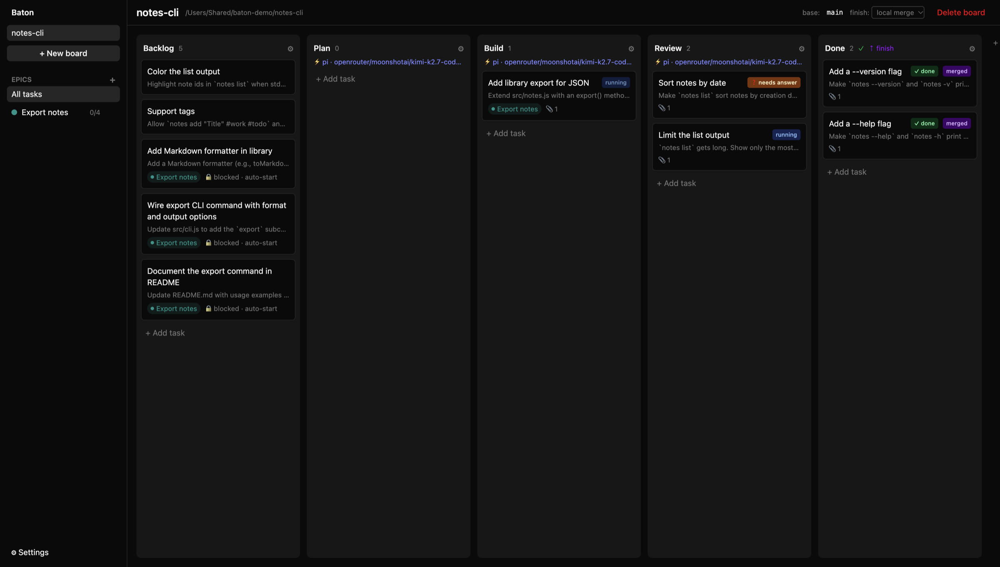
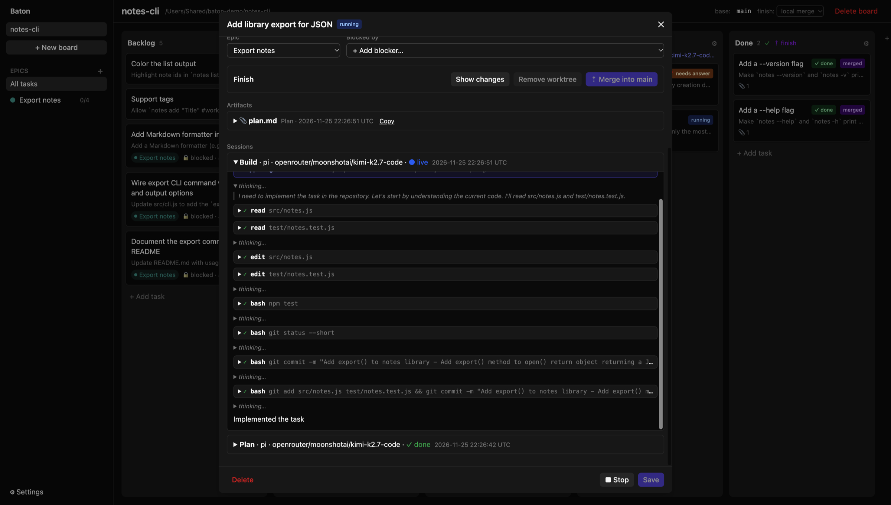
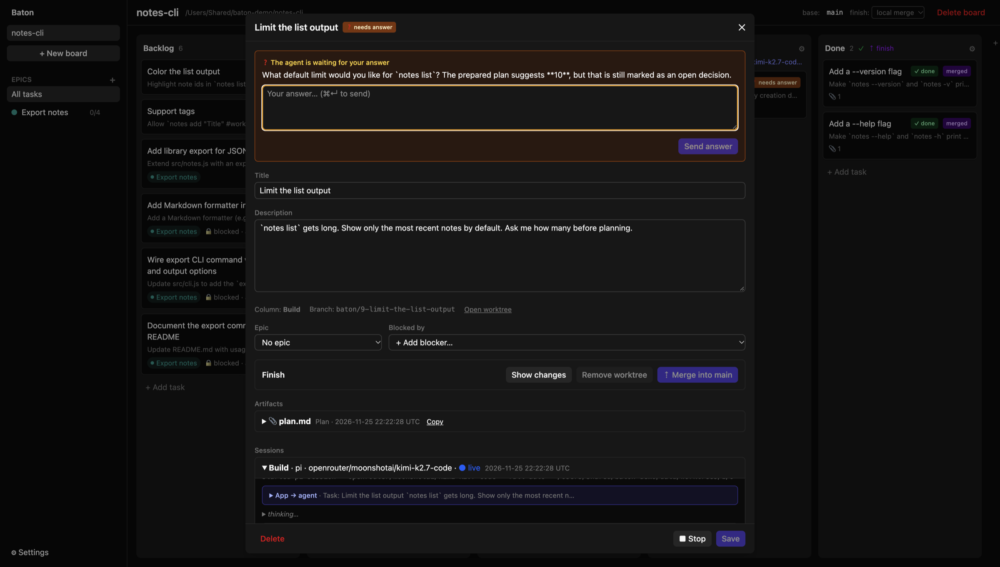
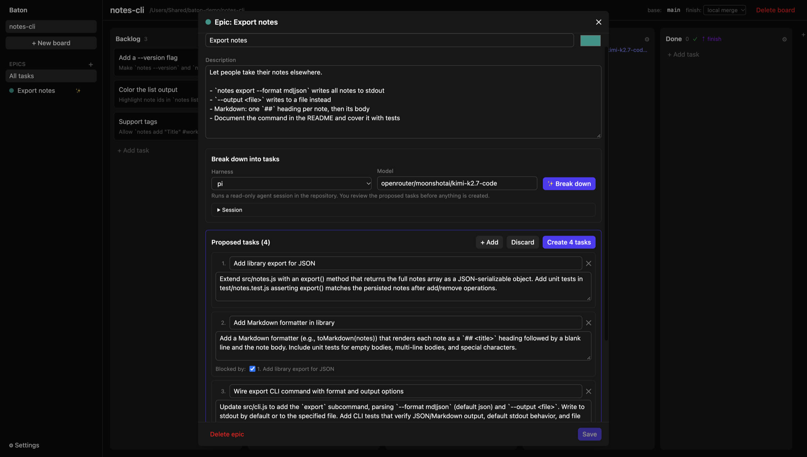
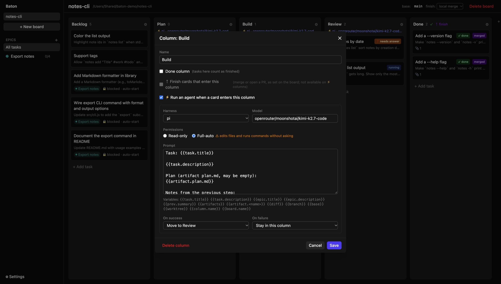
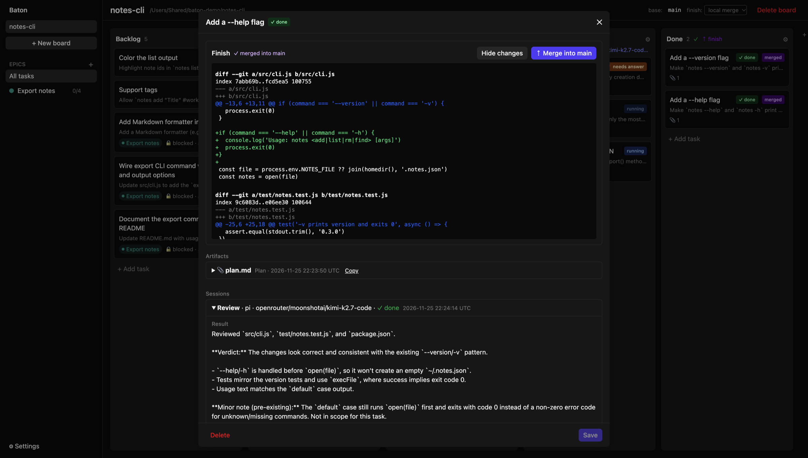

<p align="center"></p>

<h1 align="center">Baton</h1>

<p align="center">A kanban board that hands each card from coding agent to coding agent, column by column.</p>

<p align="center"></p>

---

Baton is a desktop app for running local coding agents through a workflow you design. Each board points at a git repository. Each column can carry a **trigger**: when a card enters it, Baton starts an agent session (with the harness, model, permissions and prompt you configured for that column) in the card's own **git worktree**. When the agent finishes, the card moves on to the next column, so a typical card goes Plan → Build → Review → Done without you touching it. If the review finds something that must be fixed, the card goes back to Build with the findings.

> **Status: early.** Runs on macOS. Linux support is **experimental**: it builds, passes the tests and starts in CI, but hasn't seen real-world use yet. Windows isn't supported yet. Supported agent harnesses: [Claude Code](https://code.claude.com) (`claude`), [pi](https://pi.dev) and the [Antigravity CLI](https://antigravity.google) (`agy`). Adapters for Codex and OpenCode are planned; see [Adding a harness](#adding-a-harness).

## Features

- **Configurable columns.** Add, rename, reorder and delete columns. Any column can run an agent when a card enters it, read-only or full-auto, and send the card onward on success or failure.
- **Live agent sessions.** One session per card per column, with the full transcript streamed live: prompts, agent text, and every tool call with its input and output. If the agent stops early, Baton tells it to continue in the same session.
- **Questions, artifacts and notifications.** Agents can pause and ask you something; your reply continues the same session. Agents can also save documents (plans, review findings) that later columns use as prompt variables. Desktop notifications and unread rings/counts mark cards and boards when an agent asks a question, finishes, or fails.
- **Epics and brainstorming.** Describe a larger piece of work—or click **💬 Brainstorm** to let a read-only agent explore the repo, ask clarifying questions, and write the scope and acceptance criteria—then break it down into tasks with dependencies and edit the draft before creating the cards.
- **Dependencies.** A blocked card waits, then moves to the next ⚡ column and starts once all its blockers have succeeded. Its worktree merges in the blockers' branches first.
- **Finishing and archiving.** Per board, a finished card either merges into the base branch locally or opens a pull request (tasks inside an epic get stacked PRs). Archive completed cards in **Done** in one click while keeping their history and resolved dependencies.
- **Isolation.** Every card works on its own branch in its own worktree, so several agents can run in parallel (the limit is configurable).

## Screenshots

**The board.** Cards run through Plan → Build → Review → Done. One is waiting for an answer, epic tasks start automatically once their blockers are done, and finished work is merged.



**A live session.** Everything the agent does, as it happens: its thinking, every tool call with input and output, and its replies.



**Agents can ask.** The session pauses, the card shows *needs answer*, and your reply continues the same session.



**Epics.** Describe the work, let an agent break it into tasks with dependencies, edit the draft, then create the cards.



**Columns are configurable.** Pick a harness, model, permissions and prompt for each column, and choose where a card goes on success or failure.



**Finishing.** Review the diff, then merge into the base branch or open a pull request, automatically when a card reaches Done.



## Install (macOS)

1. Download the DMG from [Releases](https://github.com/IslamElgohary/baton/releases): `arm64` for Apple Silicon, `x64` for Intel Macs.
2. Open it and drag **Baton** to **Applications**.
3. The first time you open Baton, macOS blocks it: Baton isn't notarized by Apple yet. Open **System Settings → Privacy & Security**, scroll down, and click **Open Anyway** next to the Baton message. You only need to do this once.

   Or, in Terminal: `xattr -dr com.apple.quarantine /Applications/Baton.app`

You still need an agent harness installed and signed in (see below). Baton finds it through your login shell's `PATH`, even when opened from the Dock.

## Requirements

- macOS, or Linux with a desktop session (experimental)
- Node.js 22.5 or newer, and git
- At least one agent harness, signed in: [Claude Code](https://code.claude.com) (`claude`), [pi](https://pi.dev) (`pi`) or the [Antigravity CLI](https://antigravity.google) (`agy`)
- For pull requests: the [GitHub CLI](https://cli.github.com) (`gh`), signed in

## Getting started

```bash
git clone https://github.com/IslamElgohary/baton.git
cd baton
npm install
npm run dev
```

1. Click **Choose a repository** and pick a local git repository. New boards start with Backlog → Plan → Build → Review → Done.
2. Open **⚙ Settings** to check that Baton found your harness (`claude`, `pi` or `agy`) and that it is signed in. New boards use the first one listed; change it per column.
3. Add a card to **Backlog** and drag it into **Plan**. Click the card to watch the session.
4. Click **⚙** on a column to change its harness, model, permissions, prompt, or where cards go on success or failure.

To run the production build instead of dev mode: `npm run build && npm start`. To build the DMGs yourself: `npm run dist:mac` (output in `dist/`).

### Column prompts

Prompts are templates. Available variables:

| Variable | Value |
|---|---|
| `{{task.title}}`, `{{task.description}}` | The card |
| `{{epic.title}}`, `{{epic.description}}` | Its epic, if any |
| `{{prev.summary}}` | Result of the card's last successful session |
| `{{artifact.<name>}}`, `{{artifacts}}` | One saved artifact, or all of them |
| `{{diff}}` | The card's changes vs the base branch |
| `{{branch}}`, `{{base}}`, `{{worktree}}` | Git details |
| `{{column.name}}`, `{{board.name}}` | Where it runs |

Baton appends a short protocol to every session's first message. The agent ends its reply with `[DONE]`, `[FAILED] <reason>` or `[QUESTION] <question>`, and saves documents as `<artifact name="…">…</artifact>` blocks.

## Safety

- **Full-auto columns run agents without permission prompts.** They can edit files and run any command. The worktree isolates git state, not your machine. Use full-auto only for repositories and prompts you trust.
- **Read-only columns are enforced by the harness.** For Claude Code, only the `Read`, `Grep` and `Glob` tools are loaded (no Bash, edits or subagents), with no MCP servers and no settings or hooks from the repository's `.claude/` folder. For pi, only the `read`, `grep`, `find` and `ls` tools are enabled, with no MCP tools and no project extensions. For Antigravity, every shell command, file write and MCP tool is denied, overriding your global allow-list. Anything other than an explicit full-auto setting falls back to read-only.
- **Local merges** only run when your main checkout is clean and on the base branch, and are aborted on conflict.
- **Quitting** stops all agent sessions. Anything still running after a short grace period is killed.

## Linux notes (experimental)

Linux support is new. If something doesn't work, please [open an issue](https://github.com/IslamElgohary/baton/issues).

- **Signing in to a harness** opens a terminal window. Baton uses `$TERMINAL` if set, otherwise the first one it finds of GNOME Terminal, Konsole, Xfce Terminal, kitty, Alacritty, WezTerm, foot, `x-terminal-emulator` or xterm. If none is found, it shows the command to run yourself.
- **"The SUID sandbox helper binary was found, but is not configured correctly"** when starting `npm run dev`: some distributions (e.g. Ubuntu 23.10 and later) restrict what Chromium's sandbox needs. Fix it once for this checkout:
  ```bash
  sudo chown root node_modules/electron/dist/chrome-sandbox
  sudo chmod 4755 node_modules/electron/dist/chrome-sandbox
  ```
- Baton reads `PATH` from your login shell (bash, zsh or fish), so CLIs installed with npm or in `~/.local/bin` are found even when it's started from a desktop launcher.

## Data

Boards live in a SQLite database in the app's data folder: `~/Library/Application Support/Baton` on macOS, `~/.config/Baton` on Linux. Worktrees are created under the same folder. `BATON_USER_DATA=/some/dir npm run dev` uses a separate folder, which is handy for experiments.

## Releasing

Bump `version` in `package.json` (through a PR), then push a matching tag: `git tag v0.2.0 && git push origin v0.2.0`. The Release workflow builds both DMGs, smoke-tests the packaged app and creates a **draft** release with the DMGs attached. Review it and publish.

## Development

```bash
npm test           # unit + integration tests (real git, fake agent harness)
npm run typecheck
npm run e2e        # real Claude Code, pi and Antigravity sessions in temp repos: needs `claude`, `pi` and `agy`, costs model usage
npm run smoke      # launch the built app and check it starts (run `npm run build` first; on Linux CI use xvfb-run;
                   # SMOKE_APP=<path to executable> checks a packaged app)
npm run dist:mac   # package dist/Baton-<version>-{arm64,x64}.dmg
npm run icon       # regenerate build/icon.png and build/icon.icns from build/icon.svg
```

See [ARCHITECTURE.md](ARCHITECTURE.md) for how the pieces fit together.

### Adding a harness

A harness is one file implementing the `Harness` interface in [`src/main/harnesses/types.ts`](src/main/harnesses/types.ts): how to start a long-lived session process, encode a user turn on stdin, parse its JSON event stream, list models, and check sign-in. Add it to the list in [`src/main/harnesses/index.ts`](src/main/harnesses/index.ts), capture a sample session into `test/fixtures/`, and add a parser test like [`pi.test.ts`](src/main/harnesses/pi.test.ts). [`pi.ts`](src/main/harnesses/pi.ts) is a compact example of an RPC-style harness. Settings, the column dialog and the runner all pick it up from the registry.

## License

[MIT](LICENSE)
